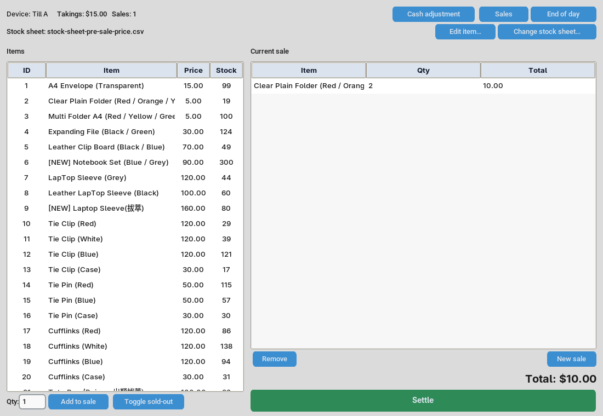
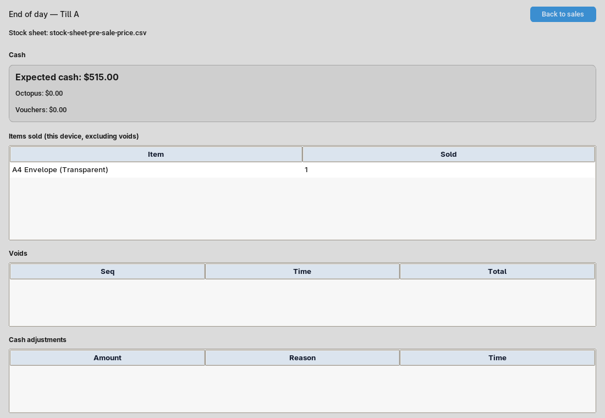

# DBS Garden Fete POS tutorial

A practical guide for colleagues using the POS at the stall. The app works
offline and saves records on the laptop where it is running. It records sales
and payment methods; it does **not** take payments, print receipts, or sync
between tills.

## 1. Start the POS and check setup

On an event laptop, open the extracted app folder and run
`DBSGardenFetePOS.exe`. Keep that folder for the event: the device's database,
log, and exports are stored there. No internet connection is needed to use the
packaged app. (For installation or running from source, see the `README.md`.)

On first use, the setup screen asks for:

1. **Stock sheet CSV** — click **Browse...** and choose the organizer's CSV.
   It must have these columns, in this order:
   `ItemID, ItemName, Price, Inventory, Sales, Revenue`.
2. **Starting float (HK$)** — enter the cash float put in this till at the
   start. Check the amount with the person responsible for the cash.
3. **Device name** — enter a clear, distinct name such as `Till A` or `Till B`.
   This name identifies the till in exports.

After the CSV reports that its items loaded and the float and device name are
correct, click **Start the day**. Setup is saved on this device. On later
launches, the POS returns directly to Sale using its saved catalog; it does not
need to reread the original CSV.

## 2. Ring up a sale

The Sale screen has the catalog on the left and the **Current sale** on the
right. The screenshot uses sample data; its figures are illustrative.

1. In **Items**, select the correct row. Check the item name, Item ID, and
   price.
2. Set **Qty** to the number of items to add to the current sale (a whole
   number; it starts at 1).
3. Click **Add to sale**. The item and its total for that sale line appear in
   **Current sale**.
   Adding the same item again increases its quantity. Check the running total
   before taking payment.
4. To change a quantity already in the current sale, double-click its **Qty**
   cell, type the new quantity, then press Enter or click elsewhere to save.
   Press Escape to cancel that edit. To remove a sale line, select it and click
   **Remove**.
5. Click **Settle**, choose the actual payment method, enter the requested
   amount(s), and click **Settle** in the dialog. The POS records the sale and
    shows its sequence number and any cash change due. The current sale clears
    after a successful settlement, ready for the next customer.

### Payment choices

The settlement dialog offers **Cash**, **Voucher**, **Octopus**, and
**Cash + Voucher**. The payment method is a record for reconciliation; the
cashier still handles payment and uses the separate Octopus machine.

- **Cash:** enter the notes/coins handed over as **Cash tendered**. The amount
  applied to the sale is the sale total; the dialog reports change due.
- **Voucher:** select **Voucher**; the POS records the full sale total as paid
  by voucher. The stall gives no change for vouchers.
- **Octopus:** first take the full payment on the shared Octopus machine, then
  select **Octopus** here and settle; the sale total is recorded automatically.
  Octopus must cover the entire sale by itself; it cannot be combined with cash
  or vouchers. The POS is not connected to the machine.
- **Cash + Voucher:** enter the cash portion, the cash tendered, and the voucher
  portion. Both portions must be positive and together equal the sale total;
  the cash tendered must be at least the cash portion. For a single payment
  method, choose **Cash** or **Voucher** instead.

If the amounts do not match the sale total, the POS rejects settlement; correct
the amounts and try again. Keep following the stall's normal handwritten order
sheet process: the POS does not print a customer receipt.

### What the stock number means

The displayed remaining quantity is an estimate for this device: starting
quantity minus this device's completed, non-void sales for that item. A blank
`Inventory` field is shown as `—`. It is not a live shared count, and another
till's sales, physical restocks, or losses are not included. The POS does not
automatically mark an item sold out when this estimate reaches zero. When the
cashier decides to mark an item **Sold out**, select it and click
**Toggle sold-out**; while marked, the POS blocks adding it to a sale. Click the button again only if it is available
again.

**New sale** clears the current, unsettled sale. Use it only when you intend to
discard that in-progress order; it does not record or settle anything. A
successfully settled sale clears automatically.

## 3. Other Sale-screen controls

- **Takings** and **Sales** at the top summarize this till's completed sales.
  Takings includes all payment methods, not just cash; voided sales are
  excluded.
- **Sales** opens the recorded-sales list. Select a sale to use **Correct...**
  or **Void** (see [Correct a recorded sale](#4-correct-a-recorded-sale)).
- **Cash adjustment** records cash added to or removed from the drawer. Enter a
  positive amount for cash added or a negative amount for cash removed, and
  give a reason, then click **Record**. This changes expected cash, but is not a
  sale and does not change Takings.
- **Edit item...** changes the selected catalog item's name, price, or starting
  quantity for future sales. It is available only when the current sale is
  empty; it edits an existing item, not the list of Item IDs. It does not change
  the source CSV or rewrite completed sales. Click **Save** to apply the edit.
  Starting quantity here means the Stock sheet's `Inventory` field; previous
  sales are still deducted from the displayed estimate.
- **Change stock sheet...** loads a different catalog/price CSV for future
  sales. See [Change the active stock sheet](#5-change-the-active-stock-sheet).
- **End of day** opens the per-device review and export screen.

## 4. Correct a recorded sale

Use **Sales** to open the list, select the sale by its sequence number, and
choose the appropriate action. These actions change the POS record; they do not
take payment or issue a refund.

- **Correct...** records a Correction to a completed sale's items, quantities,
  and settlement. Adjust or remove an incorrect sale line, or choose a catalog
  item and quantity and click **Add line** to add a missing item. Check the new
  total and payment
  amounts, then click **Save correction**. Added items use the active catalog's
  current name and price. Existing sale lines retain their recorded name and
  price; their quantity can be adjusted or the sale line removed. A correction
  keeps the original sequence number and replaces its contribution to totals and
  sold counts.
- **Void** asks for confirmation and marks the sale voided. It remains visible
  for audit but is excluded from takings, expected cash, and sold counts. A
  voided sale cannot be corrected in the POS.

Take care to select the intended sale. If payment has already been made,
follow the event organizer's instructions for handling the real-world cash,
voucher, or Octopus payment as well.

## 5. Change the active stock sheet

Use this when the organizer has provided a new price sheet (for example, moving
from presale prices to marked prices).

1. Finish the current sale or remove its items; the POS will not change sheets
   while the current sale contains items.
2. Click **Change stock sheet...**, choose the CSV, and read the confirmation
   before accepting it.
3. Check the filename and item prices shown on Sale before taking another
   order.

The new sheet supplies names, prices, and starting quantities for future sales;
it does not re-price completed sales, and the source CSV is not modified. If
the same items keep the same `ItemID` and use the correct starting quantity,
this till's earlier non-void sales continue to reduce the estimate.
For matching Item IDs, an existing manual Sold out mark remains when the
starting quantity is unchanged. It clears if the quantity changes and the
recalculated remaining quantity is positive; a new Item ID starts unmarked.
Sales for Item IDs missing from the active sheet remain in the history, but are
not rows in that sheet's stock report. A sheet change makes you need a fresh export
before wiping.

For the Saturday-presale to Sunday-marked-price workflow, see `RUNDOWN.md` for
the detailed two-day instructions and examples.

## 6. Review and export at end of day

Click **End of day**. The screen reports figures for this device only:

The following example also uses sample data; its figures are illustrative.

- **Expected cash** = starting float + completed cash sales + cash adjustments.
  Compare it with the cash physically counted in this till.
- **Octopus** and **Vouchers** are shown separately. Compare Octopus against
  the shared machine's report as directed by the organizer.
- **Items sold** shows this device's final, non-void quantities. **Voids** and
  **Cash adjustments** are listed separately.

Click **Back to sales** to return to the Sale screen. This does not reset the
figures or clear the current catalog.

Click **Export CSV**, choose a destination folder, and click **Export**. Save
the files somewhere the organizer can access. Each export creates:

- `sales.csv` — one row per recorded sale, including status and payment
  totals.
- `items.csv` — sale lines with item name, quantity, and price. It does not
  contain Item IDs.
- `stocks-<device name>.csv` — the active stock sheet's rows with this device's
  calculated Sales and Revenue. Its `Inventory` column is the starting-quantity baseline,
  not a remaining count.

Use a separate folder for each till (and, for a multi-day event, each day),
because `sales.csv` and `items.csv` have the same names on every till and a
later export to the same folder replaces them. Each device exports its own
records; the POS does not sync or combine tills. The organizer combines them.

End of day is a review and export, **not** a reset. Figures and later exports
remain cumulative on that device. For a two-day event, the Sunday export already
includes Saturday activity from that device; do not add Saturday's snapshot to
the Sunday cumulative total.

## 7. Wipe only after the event is finished

**Wipe for end of event** permanently deletes this device's sales, catalog,
adjustments, and setup. Do not use it for an ordinary end-of-day review or
between event days.

Before wiping, verify that all required exports from **all** tills are saved in
the correct folders. The POS requires a fresh export after the latest sales,
adjustments, or catalog changes. To proceed, click **Wipe for end of event**,
type `wipe`, and confirm with **Wipe database**. This cannot be undone; the
device will need setup again afterwards.

## Quick checks during service

- Confirm the active stock sheet filename and price before each service period.
- Check the item, quantity, and total before settling; check cash change due.
- Use distinct device names and keep each device's database with that till.
- Do not assume a stock count includes another till or that the POS took a
  payment; verify cash and Octopus on their respective devices.
- Export before any wipe, and keep till/day exports separate.
